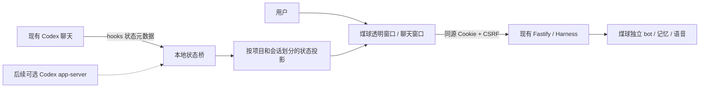

# 煤球陪伴桌宠：接入调研与动画制作方案

调研日期：2026-10-26。工作分支：`research/hedgehog-companion`。源码基线：`6d4e5b0`。

## 结论

建议第一版采用 **Electron 透明桌宠窗口 + 当前项目独立煤球 bot + Codex hooks 状态桥接**。

日常聊天、记忆和语音继续走现有 Harness；桌宠负责形象、动作、气泡、聊天入口和专注交互。Codex 保持现有工作入口，桌宠根据工作状态思考、敲键盘、等你确认或庆祝。用户以后希望直接对煤球说“帮我改这个项目”时，再增加 Codex app-server 编程入口。

本轮交付是可审阅的接入方案、连续动画素材、播放清单、预览页和素材检查；尚未实现或安装 Electron 桌面应用，也没有给正在使用的 Codex 安装 hooks。预览中的 coding 流程明确标为模拟。

当前目录原本没有 `.git`。本次建立了本地 Git 源码基线，再创建研究分支；密钥、数据目录、虚拟环境、旧 SQLite 文件 `v1` 均排除。没有配置远程仓库或推送。

## 1. 当前工程真正可以复用什么

以代码和测试为准；README 的部分“后续阶段”描述早于现在的正式入口。

| 能力                                    | 已核对的代码                                                                | 接入方式 / 限制                                                                                          |
| --------------------------------------- | --------------------------------------------------------------------------- | -------------------------------------------------------------------------------------------------------- |
| 每个 bot 独立人格、数据库、队列与执行器 | `src/bots.ts` 的 `BotManager.open/create`；`tests/bots.test.ts`             | 创建独立“煤球”角色，保存创建接口返回的 id，不混入小野等角色的数据                                        |
| 正式记忆基线                            | `src/main.ts`、`src/memory/stable-config.ts`                                | 当前正式入口启用 CM3 和 fast path、reply guard；向量和摘要关闭，不为桌宠另造一套记忆                     |
| 聊天与取消                              | `POST /v1/threads/:id/inputs`、`POST /v1/runs/:id/cancel`                   | 线程 id 从 `/bootstrap` 获取；发送携带幂等键和 `x-bot-id`，断线不重复发送                                |
| 快照与增量状态                          | snapshot、events 路由；`PublicEvent`                                        | 先取 snapshot，再从 cursor 订阅 SSE；重连恢复状态，不重新生成回复                                        |
| 回复处理状态                            | `Run.progress.phase`、`web/run-status.js`                                   | 记忆读取 / 生成 / 发布检查期间播放 think；只有已发布文本才进入聊天气泡                                   |
| 语音输入与朗读                          | `/v1/voice-input`、`/v1/transcriptions`、`/v1/speech`；`web/voice-input.js` | 录音先转可编辑草稿再发送；只有音频真正开始播放才做说话口型；停止时同步结束口型                           |
| 本地会话保护                            | `src/server.ts` 的 onRequest、`/bootstrap`                                  | localhost Host/Origin 校验、HttpOnly Cookie、CSRF；桌宠继续使用同源页面和现有边界                        |
| 主动触达和免打扰                        | Settings、FollowUp、Outbox                                                  | 当前 CM3 路径拒绝启用主动发送，不能因为旧模块存在就声称桌宠已能主动发消息；P1 先做本地、无模型的动作陪伴 |

人格建议：煤球是困困但细心的小刺猬，表达简短温暖，有一点小脾气。可以安静陪工、听用户聊天、回应完成的小进展；不能假装已经看过没有共享的代码或知道测试结果。

## 2. 桌面壳选择

| 路线           | 与本项目的匹配                                              | 代价                                                              | 决策                       |
| -------------- | ----------------------------------------------------------- | ----------------------------------------------------------------- | -------------------------- |
| Electron       | 当前前后端均为 JS/TS，便于复用页面、Canvas 和 Node 侧状态桥 | 需要实测内存、启动、耗电和原生 SQLite 模块打包                    | **优先做最小闭环**         |
| Tauri          | 可提供透明置顶窗口和鼠标事件控制                            | 引入 Rust、WebView 差异，以及 Node 服务 sidecar 的打包 / 生命周期 | 保留备选，待首版测量后决定 |
| 纯浏览器 / PWA | 可以作为素材和聊天验证入口                                  | 很难完成桌面透明窗口、点击穿透和跨应用常驻                        | 本轮只用于预览             |

窗口采用两个独立窗口：小的透明煤球窗口与可展开聊天窗。宠物窗口从 128×128 逻辑像素开始，提供 64/96/128/192 尺寸设置；聊天窗不随宠物缩放。透明留白不能挡住编辑器鼠标，交互区需要做 alpha 命中测试，macOS 原生点击穿透与拖动还需真机验收。无抢焦点、专注模式、托盘暂停、开机启动后置。

Electron 官方提供自定义拖动区域与点击穿透机制，拖动区域会吞掉指针事件，因此不能把整个煤球同时当“点击聊天”和拖动区；建议单击打开聊天、按住后拖动，由专门的窗口控制逻辑处理。[官方交互说明](https://www.electronjs.org/docs/latest/tutorial/custom-window-interactions)

渲染层关闭 Node integration，保留 context isolation / sandbox，preload 只开放明确的窗口动作；模型 Key 留在现有服务侧。[Electron 安全说明](https://www.electronjs.org/docs/latest/tutorial/security)

Tauri 的透明窗口并非不可行。当前文档已注明 `macOSPrivateApi` 在 2.12.1+ 不再生效，不能沿用旧教程“一定需要手动开启该标志”的结论。选 Electron 是本项目复用成本的判断，不是对 Tauri 透明能力的否定。[Tauri 配置](https://v2.tauri.app/reference/config/#appconfig)

### 进程与数据归属



开发期桌宠页面由现有服务的静态路由提供，同源加载，避免为 `file://` 或 `tauri://` 放开当前 Origin 校验。若已有 bot 服务，连接它；若由桌面壳启动服务，记录“由谁启动”，只关闭自己拥有的子进程。禁止两个进程同时打开同一个 bot 数据库；沿用 `acquireInstance` 保护。正式打包时须单独验证 Node 运行时与 better-sqlite3 ABI，不能直接把现有 node_modules 塞进 Electron 就当完成。

## 3. 跟随你现在使用的 Codex

### 路线 A：hooks 做旁观式 coding 陪伴（推荐先做）

官方支持 `UserPromptSubmit`、`PreToolUse`、`PermissionRequest`、`PostToolUse`、`Stop`、`Interrupt`、`SessionStart/End` 等生命周期 hooks。command hook 从 stdin 接收 JSON；普通 hook 需要在 Codex 中审核和信任，修改定义后需要重新信任。项目目录中的 hooks 还依赖项目信任。[官方 hooks 文档](https://learn.chatgpt.com/docs/hooks)

建议 hook 只提取事件名、session/turn id、tool id、工具类别、时间和结果类别，发给回环地址上的桌宠桥。**不读取 transcript_path，不转发完整 prompt、源码、命令、工具输出或聊天正文。** hook 的 stdout 返回 `{}`，不返回批准、拒绝或让 Codex 继续工作的指令。

桥接口与浏览器 Cookie/CSRF 接口分开：仅回环地址；使用本机 0600 文件中的随机 token；大小上限、token 校验、项目绑定、去重与时间窗口检查。不为 hook 放开现有服务的身份校验。每个事件处理应有严格短超时（例如 300ms），桥不可用就静默退出，不能阻塞编程工作；具体值为待验收的设计目标。

| Codex 事件                               | 煤球行为                                | 语义注意                                             |
| ---------------------------------------- | --------------------------------------- | ---------------------------------------------------- |
| UserPromptSubmit                         | think                                   | 收到任务，不代表已经开始改代码                       |
| PreToolUse 的 apply_patch / Edit / Write | code                                    | 只根据明确工具类别，不扫描工具参数猜测               |
| 其他 PreToolUse                          | think / 安静待机                        | 不能将所有工具调用都称为“敲代码”                     |
| PermissionRequest                        | 暂停工作动作，挥手一次 + “需要你看一下” | 批准仍在 Codex 中完成                                |
| PostToolUse                              | 更新当前工具集合，完成后回 think        | 单个工具结束不代表整个回合成功                       |
| Stop                                     | happy 一次，然后 idle                   | 只表示本回合结束，不能断言测试通过、PR合并或任务达标 |
| Interrupt / SessionEnd                   | 清理活动状态，回 idle                   | 不自动续跑、不重复庆祝                               |

项目过滤使用 canonical cwd/repo root；多会话通过用户显式绑定选择，不能把别的项目的工作混到当前煤球上。并行工具用活动 id 集合记录，后到的旧事件不能覆盖新回合。hooks 进程必须短暂退出，不能在 hook 内建立一个常驻动画循环。

**验证边界：** 本机 CLI 版本为 `codex-cli 0.146.0`。本轮核对了官方文档，并成功离线导出了该二进制的 app-server schema；没有实际安装 hooks，也没有验证当前桌面 app 构建是否会在既有活动聊天中加载新 hook。P2 必须做一次受控的真实事件验收，不能把官方支持直接等同于你正在运行的聊天已连接。连接前界面应显示“未连接”，不能用固定计时冒充实时状态。

### 路线 B：app-server 让煤球直接接收编程请求（后续）

官方 app-server 提供线程、回合、审批和流式事件；适合自定义客户端。首选本地 stdio JSONL，依次 initialize / initialized，然后显式选择或创建线程，监听 turn / item 状态。WebSocket 在当前文档仍标为实验性，首版无需暴露网络监听。[官方 app-server 文档](https://learn.chatgpt.com/docs/app-server)

当前本机 schema 确认存在 `thread/list`、`thread/resume`、`thread/status/changed`、`turn/started`、`turn/completed`、`item/started`、`hook/started/completed`。schema 生成记录在忽略的 `local-data/hedgehog-research/codex-schema/`，可用相同命令重新生成：

```sh
codex --version
codex app-server generate-json-schema --out local-data/hedgehog-research/codex-schema
```

独立启动一个 app-server 不等于自动订阅桌面 app 里所有活动聊天，也不能偷偷 resume 正在用的聊天。P3 通过明确的“在煤球里开始 coding”入口管理自己的会话；如需共享已有会话，必须使用该版本正式支持的连接 / 选择机制并单独验收。

用户可继续使用 Codex 自身的登录方式；不能把现有 DeepSeek/Grok 的 Key 当作 Codex 登录凭据。桌宠聊天继续使用项目已有模型配置，不因名称里有 GPT 就自动换模型。若以后要求日常聊天也走 GPT，再单独增加 provider 与配置。

## 4. 动画状态与聊天记忆的边界

桌宠动作是界面状态投影，不能写成“共同经历”或注入长期记忆。来自 Codex 的成功 / 失败 / 等待状态不自动调用聊天模型。默认状态策略优先用户交互、语音播放、需要注意的工作状态，随后才是随机小动作；专注时关闭随机走路、庆祝音效和打断气泡。进入睡眠状态只说明桌宠显示睡姿，不代表 bot 离线或拒绝接收消息。

本项目 `message.completed` 在某些失败降级下也可能出现，不能看事件名就庆祝；需要读取关联 run.status / payload.status。SSE 回放可恢复快照，但旧的完成事件不再触发庆祝和通知。语音与 coding 同时发生时，优先播放聊天口型，语音结束再根据仍然活动的 coding 状态恢复。

建议投影对象（设计，尚未实现）：

```json
{
  "schemaVersion": 1,
  "source": "codex-hook",
  "projectId": "local-project-binding",
  "sessionId": "selected-session",
  "turnId": "active-turn",
  "phase": "working",
  "toolKind": "file-edit",
  "updatedAt": 0
}
```

状态按 source / project / session / turn 分区，断线转 disconnected；没有心跳不能凭短超时宣告 Codex 空闲。hook 事件不足以确定长任务是否仍活动时，显示“状态暂不可确认”，可回 idle 动作但保留连接提示。无需为每一帧记日志或创建 LLM 调用。

Kimi 只采用一个适合当前项目的不变量：事件订阅属于对应 agent/session 生命周期，解除订阅后不得继续更新 UI。证据来自固定快照 `MoonshotAI/kimi-code@9e1248416faa22d9f0b777b91ad092bbf1e19182` 的 `app/event/eventBus.ts`、`eventBusService.ts` 和 `test/app/event/eventBus.test.ts`（按类型过滤及 dispose 后不再接收事件）。决策为 **Adapt**：复用本项目已有 SSE 和 change/shutdown 清理方式，不引入 Kimi 的 DI、全新持久事件总线或 agent kernel。

## 5. 连续动画制作与交付

之前的20动作图是姿势概念稿，不能按格顺序播放成流畅动画。这次以已确认的暖栗棕母图为身份参考，给每个动作单独生成8帧时间连续的透明 sprite sheet，再进行固定尺寸导入、脚底对齐和播放检查。

采用 PNG RGBA + JSON 帧时长作为应用资源；GIF 只用于查看。Aseprite 官方支持按网格导入 sprite sheet、按 tags 导出，以及 CLI 导出 PNG 和 JSON；后续需要像素级手工精修时可沿用这些交付文件。[Sprite sheet 文档](https://www.aseprite.org/docs/sprite-sheet/)、[CLI 文档](https://www.aseprite.org/docs/cli/)

| 动作 id | 内容                 | 播放规则                                  |
| ------- | -------------------- | ----------------------------------------- |
| idle    | 待机呼吸、眨眼       | 循环                                      |
| walk    | 小步走路             | 原地步态循环，桌面位移另由窗口控制        |
| talk    | 开口聊天             | 有文本 / 语音播放时使用，非音素级口型同步 |
| think   | 歪头思考             | 循环                                      |
| code    | 小键盘敲代码         | 循环                                      |
| happy   | 开心蹦跳             | 播放一次，回 idle                         |
| sleep   | 蜷着睡觉呼吸         | 循环                                      |
| wave    | 挥手                 | 播放一次，回 idle                         |
| fruit   | 抱着大红果子啃       | 循环                                      |
| heart   | 比心，冒出粉桃心     | 循环                                      |
| sign    | 举牌“飞飞爱你”       | 循环，逐帧核对文字                        |
| cake    | 背着草莓蛋糕开心轻晃 | 循环                                      |

输出目录为 `assets/hedgehog/v1/`：

- `source/`：确认母图和20动作概念稿。
- `raw/`：ImageGen 生成的透明8帧原始表，保留可追溯源图。
- `frames/<action>/00.png … 07.png`：128×128、硬 alpha、最近邻采样的单帧。
- `sheets/<action>.png`：1024×128、从左到右8帧的应用图集。
- `manifest.json`：每帧路径、图集位置、时长、循环规则、SHA-256；锚点 `(64,116)`。
- `generation.json`：生成工具、母图、网格和提示词。
- `qa.json`：透明度、图像尺寸、不同帧数量、导入坐标及源图边界数据。
- `previews/`：GIF、截图和交付预览；`index.html` 是交互播放器。

导入脚本使用 Canvas 对 ImageGen 内容做确定性的裁格、对齐和最近邻缩放，不用代码代画角色。生成源图的边长未必能被4×2整除，按四舍五入边界划分，不丢掉源像素。每段采用一个统一比例，避免逐帧缩放把角色呼吸变成大小抖动；跳跃保留有限的脚底离地偏移。

复现处理与预览：

```sh
node scripts/hedgehog/build-assets.mjs
node scripts/hedgehog/serve-preview.mjs
# 打开 http://127.0.0.1:4347
```

构建依赖当前项目的 Playwright Chromium 和本机 FFmpeg，未给主项目增加美术依赖；Aseprite 当前未安装。PNG 和清单可直接接入 Canvas 渲染器，不需要在用户电脑运行 ImageGen 或 FFmpeg。

**品质界线：** 这是一版可播放、可集成的动画原型。自动检查能证实尺寸、透明底、帧数量与资源完整，不能证明每根刺逐帧一致；生成式动画仍需在循环接缝、跨动作体型和128px中文招牌上做人工视觉复核。最终像素级定稿可以在 Aseprite 中固定母体轮廓再精修。本轮的真人使用体验、桌面耗电和完整 bot/Codex 联调不算已验收。

## 6. 推荐实施顺序与验收门槛

1. **P0，本轮：** 分支、源码接入调研、12段96帧、PNG/图集/清单/GIF/预览及验证记录。
2. **P1，桌面聊天闭环：** Electron 小窗口、拖拽/尺寸/托盘、独立煤球 bot、同源聊天与取消、SSE 重连、免打扰。先手动发送聊天，不打开当前 CM3 不支持的主动发送。
3. **P2，跟随现有 Codex：** 受控安装并信任 hooks、token 桥、项目/会话绑定、动作投影，真实观察提交/工具/审批/结束/中断。成功后再提供用户安装向导。
4. **P3，可选直接 coding：** app-server 登录/会话选择/发起任务/流式状态/取消/审批 UI。这个阶段才把煤球做成 coding 任务入口。

P1 验收：两个角色消息/记忆不串；取消不残留说话口型；断线重连不重发；正式服务只被一个进程持有；小窗口不遮挡透明区点击，不抢编辑器焦点；缩放清晰；隐藏 / 锁屏时暂停动画和录音。

P2 验收：桥未启动时 Codex 正常工作；拒绝未知 token / 其他项目；并行工具不提前结束忙碌状态；Stop 不宣称测试通过；旧回合重放不庆祝；审批动作回到 Codex；hook 返回值不改变代理决策；本机当前 app 和 CLI 分别验证。若旧 app 未触发 hooks，显示不支持 / 未连接，并让用户选用支持版本或受控 app-server 入口。

性能目标先测再定：可见时仅按帧时长调度；idle 不产生模型调用；每帧不发网络；隐藏时停止绘制。记录同机基线与桌宠运行时的 RSS、CPU、启动耗时和1小时耗电差异，不能仅凭框架名称承诺“很省资源”。

## 7. 本轮验证记录

详细结果见同目录 `hedgehog-desktop-validation.md`，包括素材和预览检查、现有 bot 接口回归、尚未执行的真实桌面 / 模型 / Codex 联调。
